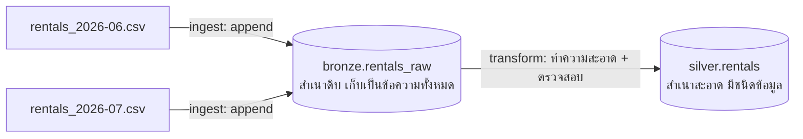

# การบ้าน: Ruam Bike Lakehouse ด้วย pyducklake

Nov 10, 2026 · @Natawut

ในการบ้านนี้ นักศึกษาจะสร้าง lakehouse ขนาดเล็กที่มี 2 layer ให้บริษัทให้เช่าจักรยานแห่งหนึ่งด้วย pyducklake โดยเขียนฟังก์ชัน 4 ตัว คือ q1–q4 ไว้ใน `student.py`

## สถานการณ์

**Ruam Bike** เป็นบริการให้เช่าจักรยาน (บริษัทสมมติ) ในกรุงเทพฯ สมาชิกปลดล็อกจักรยานที่สถานีหนึ่ง ปั่น แล้วนำไปคืนที่สถานีใดก็ได้ มีสถานีทั้งหมด 5 แห่ง ได้แก่ **Siam, Samyan, Chamchuri, Lumphini, Silom**

ทุกเดือน ระบบจองของ Ruam Bike จะ export การเช่าทั้งหมดออกมาเป็นไฟล์ CSV หนึ่งไฟล์ ข้อมูลไม่ได้สมบูรณ์ทุกแถว บางแถวมีค่าหายไป บางแถวไม่สมเหตุสมผล (เช่น การเช่าที่สิ้นสุดก่อนเริ่ม) และบางครั้งไฟล์ก็ถูกโหลดซ้ำสองครั้งโดยผิดพลาด

ทีมปฏิบัติการต้องการ 2 อย่าง:

1. เก็บ**ทุก**แถวไว้ตามที่ได้รับมา ไม่ให้ข้อมูลใดสูญหาย
2. มีตารางที่**สะอาด**และเชื่อถือได้ สำหรับทำรายงาน เช่น รายได้ต่อสถานี

นักศึกษาจะสร้างสิ่งนี้เป็น lakehouse ขนาดเล็กที่มี 2 layer แบบเดียวกับ tutorial MetroRide:



- **Bronze** = สำเนาดิบ ทุกค่าถูกเก็บเป็นข้อความ (text) เหมือนใน CSV ทุกประการ พร้อมคอลัมน์เพิ่มเติมอีกเล็กน้อยที่บอกว่าแถวนั้นมาจากไหน
- **Silver** = สำเนาสะอาด ค่าต่างๆ มีชนิดข้อมูลจริง (เวลา จำนวนเงิน วันที่) และมีเฉพาะแถวที่ผ่านกฎการตรวจสอบ (validation rules) เท่านั้น

เนื่องจาก DuckLake จำทุกการเปลี่ยนแปลงไว้เป็น **snapshot** นักศึกษาจึงย้อนกลับไปดูได้ด้วยว่าตารางเคยมีหน้าตาอย่างไรในอดีต ("time travel")

## ภาพรวมของงาน

แต่ละข้อคือฟังก์ชันหนึ่งตัว ทำงานตามลำดับ และแต่ละข้อจะทำงานต่อจาก lakehouse ที่ข้อก่อนหน้าทิ้งไว้

| ข้อ | สิ่งที่ต้องทำ | ทักษะ pyducklake ที่ใช้ |
| --- | --- | --- |
| q1 | สร้าง 2 layer และตารางของแต่ละ layer | `create_namespace`, `Schema.of`, `create_table`, transaction |
| q2 | โหลดไฟล์เดือนมิถุนายนเข้า bronze แล้วทำความสะอาดเข้า silver | `append`, commit message, SQL (`TRY_CAST`, `NOT EXISTS`, `QUALIFY`) |
| q3 | ตอบคำถามเกี่ยวกับข้อมูล โดยไม่แก้ไขอะไรเลย | `scan`, `select`, `count`, `to_duckdb`, SQL |
| q4 | โหลดเดือนกรกฎาคม ข้ามไฟล์ที่ถูกโหลดซ้ำ แก้ข้อมูลที่ผิด และย้อนดูอดีต | `upsert`, `delete`, snapshot, `with_snapshot` |

## Environment และไฟล์

ใช้ version เดียวกับ tutorial MetroRide ถ้า tutorial รันบนเครื่องของนักศึกษาได้ การบ้านนี้ก็รันได้เช่นกัน

| Package | Version |
| --- | --- |
| Python | 3.14 ขึ้นไป |
| pyducklake | 1.0.18 |
| duckdb | 1.5.5 |
| pyarrow | 25.0.1 |
| pandas | 3.0.6 |
| pytz | 2026.5 |

ติดตั้งและรัน:

```
uv sync                    # ติดตั้ง version ที่กำหนดไว้ใน pyproject.toml
uv run python student.py   # รัน q1 → q4 กับข้อมูลตัวอย่าง
```

(ถ้าใช้ pip: `pip install pyducklake==1.0.18 duckdb==1.5.5 pyarrow==25.0.1 pandas==3.0.6 pytz==2026.5`)

ไฟล์ที่นักศึกษาได้รับ:

```
pyducklake-assignment/
  student.py                      ← เขียนคำตอบที่นี่ (เป็นไฟล์เดียวที่ส่ง)
  pyproject.toml                  ← version ที่กำหนดไว้
  data/
    rentals_2026-06.csv           ← การเช่าเดือนมิถุนายน
    rentals_2026-07.csv           ← การเช่าเดือนกรกฎาคม
    corrections_2026-07.csv       ← รายการแก้ไขจากฝ่ายการเงิน
```

**สิ่งที่ driver เตรียมไว้ให้** ส่วนท้ายของ `student.py` (เรียกว่า "driver") จะเตรียมทุกอย่างให้ ฟังก์ชันของนักศึกษาจึงไม่ต้องทำเอง:

- ลบและสร้างโฟลเดอร์ `lakehouse/` ใหม่ทุกครั้งที่รัน
- สร้าง catalog ชื่อ **`lake`** ดังนั้นใน SQL ตารางจะชื่อ `lake.bronze.rentals_raw` และ `lake.silver.rentals`
- ปิด data inlining ทุกการเขียนจะกลายเป็นไฟล์ Parquet
- ตั้ง time zone ของ session เป็น `Asia/Bangkok`

จากนั้นจะเรียก `q1`, `q2`, `q3`, `q4` ตามลำดับ และ print ค่าที่แต่ละข้อ return ออกมา

## ข้อมูลต้นทาง

ไฟล์รายเดือน ("rentals\_2026-0x.csv") มี 1 แถวต่อการเช่า 1 ครั้ง ช่องที่ว่างหมายถึง "ไม่มีค่า"

| คอลัมน์ | ความหมาย | ตัวอย่าง |
| --- | --- | --- |
| rental\_id | ID ของการเช่า | R0601-001 |
| member\_id | สมาชิกที่เช่าจักรยาน | M015 |
| bike\_id | จักรยานที่ใช้ | B103 |
| start\_station | สถานีที่เริ่มปั่น | Siam |
| end\_station | สถานีที่คืนจักรยาน (ว่างถ้าจักรยานหาย) | Samyan |
| started\_at | เวลาเริ่ม ตามเวลากรุงเทพฯ (`+07:00`) | 2026-06-01T08:05:00+07:00 |
| ended\_at | เวลาสิ้นสุด (ว่างถ้าจักรยานหาย) | 2026-06-01T08:27:00+07:00 |
| status | `completed` หรือ `lost` | completed |
| fare\_thb | ค่าเช่าเป็นบาท (ว่างถ้าจักรยานหาย) | 25.00 |

ตัวอย่างบางแถวจาก `rentals_2026-06.csv`:

```csv
rental_id,member_id,bike_id,start_station,end_station,started_at,ended_at,status,fare_thb
R0601-001,M015,B103,Siam,Samyan,2026-06-01T08:05:00+07:00,2026-06-01T08:27:00+07:00,completed,25.00
R0601-002,M007,B044,Lumphini,,2026-06-01T09:10:00+07:00,,lost,
R0602-001,M021,B210,Silom,Chamchuri,2026-06-02T00:20:00+07:00,2026-06-02T00:45:00+07:00,completed,30.00
```

สิ่งที่ควรสังเกตจากตัวอย่างข้างบน:

- R0601-002 คือจักรยาน**หาย** (lost) ไม่มีสถานีปลายทาง ไม่มีเวลาสิ้นสุด และไม่มีค่าเช่า
- R0602-001 เริ่มเช่าตอนเที่ยงคืน 20 นาทีของวันที่ **2 มิถุนายน** ตามเวลากรุงเทพฯ แต่ตามเวลา UTC ยังเป็นวันที่ 1 มิถุนายน (17:20) ถ้าหาวันที่ตาม UTC จะได้วันผิด ต้องหาวันที่ตาม**เวลากรุงเทพฯ**เสมอ

เวลาทุกค่าในไฟล์เป็นเวลาที่ถูกต้อง แต่ใน bronze เก็บเป็นข้อความ จึงต้องแปลงด้วย `TRY_CAST` ตอนสร้าง silver

**ไฟล์แก้ไข (corrections file)** ฝ่ายการเงินส่งรายการแก้ไขมาบรรทัดละ 1 รายการ:

```csv
rental_id,action,fare_thb
R0701-014,refare,18.00
R0701-052,void,
```

- `refare`: ค่าเช่าเดิมผิด นี่คือค่าเช่าใหม่
- `void`: การเช่านี้ไม่ควรนับ ให้ลบออก
- ทุก `rental_id` ในไฟล์แก้ไขมีอยู่แล้วใน silver

## Schema ของตาราง

คอลัมน์ต้องเรียง**ตามลำดับนี้ทุกประการ** เพราะ `append` จับคู่คอลัมน์ตามตำแหน่ง ไม่ใช่ตามชื่อ

**`bronze.rentals_raw`**: สำเนาดิบ

| # | คอลัมน์ | ชนิดข้อมูล | จำเป็นต้องมีค่า? |
| --- | --- | --- | --- |
| 1–9 | 9 คอลัมน์จาก CSV ชื่อและลำดับเดียวกัน | String | optional |
| 10 | source\_file | String (ชื่อไฟล์เท่านั้น เช่น `rentals_2026-06.csv`) | required |
| 11 | source\_row\_number | Integer (1 = แถวข้อมูลแรกของไฟล์) | required |
| 12 | file\_sha256 | String (SHA-256 ของทั้งไฟล์ เป็น hex) | required |
| 13 | ingested\_at | TimestampTZ (เวลาที่โหลดข้อมูล) | required |

**`silver.rentals`**: สำเนาสะอาด

| # | คอลัมน์ | ชนิดข้อมูล | จำเป็นต้องมีค่า? |
| --- | --- | --- | --- |
| 1 | rental\_id | String | required |
| 2 | member\_id | String | required |
| 3 | bike\_id | String | required |
| 4 | start\_station | String | required |
| 5 | end\_station | String | optional |
| 6 | status | String | required |
| 7 | started\_at | TimestampTZ | required |
| 8 | ended\_at | TimestampTZ | optional |
| 9 | fare\_thb | Decimal(8, 2) | optional |
| 10 | ride\_date | Date: วันที่ตามเวลา**กรุงเทพฯ** ของ `started_at` | required |

ตัวอย่าง: R0601-001 จาก CSV ข้างบนจะกลายเป็นแถวนี้ใน silver:

| rental\_id | member\_id | bike\_id | start\_station | end\_station | status | started\_at | ended\_at | fare\_thb | ride\_date |
| --- | --- | --- | --- | --- | --- | --- | --- | --- | --- |
| R0601-001 | M015 | B103 | Siam | Samyan | completed | 2026-06-01 08:05+07 | 2026-06-01 08:27+07 | 25.00 | 2026-06-01 |

## กฎการตรวจสอบข้อมูล (Validation rules)

Bronze รับ**ทุกอย่าง** ส่วน silver จะรับการเช่าก็ต่อเมื่อผ่าน**ทุกข้อ**ที่ใช้กับการเช่านั้น ให้ตัดช่องว่าง (trim) และแปลง `status` เป็นตัวพิมพ์เล็กก่อนตรวจ เหมือนใน tutorial

| ใช้กับ | กฎ |
| --- | --- |
| ทุกการเช่า | มีค่า `rental_id`, `member_id` และ `bike_id` |
| ทุกการเช่า | `start_station` เป็นหนึ่งใน 5 สถานี |
| completed | มีค่า `ended_at` และ `started_at < ended_at` |
| completed | มีค่า `fare_thb` และ ≥ 0 |

การเช่าที่ lost ต้องผ่านเฉพาะกฎ 2 ข้อแรก (ทุกการเช่า)

นอกจากนี้ silver จะเก็บ**เพียง 1 แถวต่อ `rental_id`** และเพิ่มเฉพาะการเช่าที่**ยังไม่มีใน silver**

ตัวอย่าง:

| rental\_id | ลักษณะของแถว | เข้า silver? |
| --- | --- | --- |
| R0601-001 | completed, Siam → Samyan, 08:05 → 08:27, ค่าเช่า 25.00 | ผ่าน |
| R0601-002 | lost ไม่มีสถานีปลายทาง เวลาสิ้นสุด และค่าเช่า | ผ่าน |
| R0603-017 | completed แต่สิ้นสุด 07:50 และเริ่ม 08:10 | ไม่ผ่าน: เวลาสิ้นสุดก่อนเวลาเริ่ม |
| R0605-030 | completed แต่ค่าเช่าว่าง | ไม่ผ่าน: การเช่าที่ completed ต้องมีค่าเช่า |
| R0608-002 | start\_station เป็น `Sukhumvit` | ไม่ผ่าน: ไม่ใช่หนึ่งใน 5 สถานี |
| R0609-011 | member\_id ว่าง | ไม่ผ่าน: ทุกการเช่าต้องมีสมาชิก |

การเช่าที่ไม่ผ่านจะยังคงอยู่ใน bronze ไม่มีอะไรถูกลบออกจาก bronze เลย

## โจทย์

การเขียนทุกครั้งต้องใช้ **commit message ตามที่กำหนดทุกตัวอักษร** สิ่งนี้สำคัญมาก เพราะข้อหลังๆ จะค้นหา snapshot เก่าด้วย message เหล่านี้ พิมพ์ผิดหรือมีช่องว่างเกินมาเพียงตัวเดียวก็จะหาไม่เจอ

### q1: สร้างตาราง

`q1(catalog)`

1. สร้าง namespace `bronze` และ `silver`
2. สร้างตาราง `bronze.rentals_raw` และ `silver.rentals` ตาม schema ข้างบน
3. ทำทั้งหมดนี้ใน **transaction เดียว** ด้วย commit message `q1: create tables` ทั้ง q1 ต้องสร้าง snapshot เพียง 1 ตัว

**Return** รายชื่อตารางในแต่ละ namespace โดยใช้ `list_tables`:

```python
{'bronze': ['rentals_raw'], 'silver': ['rentals']}
```

ใน student.py ที่แจกให้ มีการเฉลยข้อนี้ไว้อยู่แล้ว เพื่อเป็นตัวอย่างสำหรับการทำข้อที่เหลือ

### q2: โหลดเดือนมิถุนายน แล้วทำความสะอาด

`q2(catalog, csv_path)` โดย `csv_path` คือ path ของ `rentals_2026-06.csv`

**ส่วน A: ingest เข้า bronze**

1. **File guard:** คำนวณ SHA-256 ของไฟล์ ถ้า bronze มีแถวที่มี hash นี้อยู่แล้ว ให้ข้ามทั้งไฟล์
2. อ่าน CSV โดยให้**ทุกคอลัมน์เป็นข้อความ** แล้วเพิ่ม metadata อีก 4 คอลัมน์
3. **Row guard:** ตัดแถวที่ `rental_id` มีอยู่แล้วใน bronze ออก และตัด `rental_id` ที่ซ้ำกันภายในไฟล์เดียวกันออก (เก็บแถวแรกไว้)
4. append แถวที่เหลือใน transaction เดียว ด้วย commit message `q2: bronze ingest rentals_2026-06.csv`

**ส่วน B: transform เข้า silver**

1. เลือกแถวใน bronze ที่ `rental_id` ยังไม่มีใน silver (`NOT EXISTS`)
2. แปลงชนิดข้อมูลด้วย `TRY_CAST` และคำนวณ `ride_date` ตามเวลากรุงเทพฯ
3. เก็บเฉพาะแถวที่ผ่านกฎการตรวจสอบ และเก็บ 1 แถวต่อ `rental_id` (`QUALIFY`)
4. append ใน transaction เดียว ด้วย commit message `q2: silver transform`

q2 ต้องสร้าง snapshot **2** ตัวพอดี

**Return** จำนวน 3 ค่า:

```python
{'bronze_appended': 150, 'silver_appended': 141, 'rejected': 9}
```

(ตัวเลขเป็นเพียงตัวอย่าง) `rejected` = จำนวนแถวใน bronze ที่รอเข้า silver แต่ไม่ผ่านการตรวจสอบ

**เคล็ดลับ:** เขียนส่วน ingest และ transform เป็น **helper function** เพราะจะได้ใช้อีกครั้งใน q4

### q3: ตอบคำถามจากข้อมูล

`q3(catalog)`

อ่านตารางแล้วตอบคำถาม 4 ข้อ **ห้ามเขียนอะไรเลย**: q3 ต้องสร้าง snapshot **0** ตัว

| Key | คำถาม | วิธี |
| --- | --- | --- |
| `silver_rows` | ใน silver มีการเช่ากี่รายการ? | `scan().count()` |
| `lost_rentals` | ในนั้นเป็นจักรยานหายกี่รายการ? | `scan("status = 'lost'").count()` |
| `revenue_by_station` | ค่าเช่ารวมของการเช่าที่ **completed** แยกตามสถานี**ต้นทาง** | `to_duckdb()` หรือ SQL ใส่ครบทั้ง 5 สถานี (ถ้าไม่มีให้เป็น 0.0) ปัดเศษทศนิยม 2 ตำแหน่ง |
| `rejected_ids` | `rental_id` ใดบ้างที่มีใน bronze แต่**ไม่มี**ใน silver? | ใช้ `NOT EXISTS` ระหว่างสอง layer คืนค่าเป็น list ที่เรียงแล้ว |

**Return** (ตัวเลขเป็นเพียงตัวอย่าง):

```python
{'silver_rows': 141,
 'lost_rentals': 6,
 'revenue_by_station': {'Chamchuri': 512.0, 'Lumphini': 640.5, 'Samyan': 455.0,
                        'Siam': 802.25, 'Silom': 390.0},
 'rejected_ids': ['R0603-017', 'R0605-030', 'R0608-002']}
```

### q4: เดือนใหม่ ไฟล์ที่โหลดซ้ำ การแก้ไข และ time travel

`q4(catalog, month1_csv, month2_csv, corrections_csv)`

ทำตามขั้นตอนต่อไปนี้ตามลำดับ:

1. **Ingest เดือนกรกฎาคม** (`month2_csv`) เข้า bronze ด้วย commit message `q4: bronze ingest rentals_2026-07.csv`
2. **Ingest เดือนมิถุนายนอีกครั้ง** (`month1_csv`) scheduler เผลอรันซ้ำ **file guard** ต้องข้ามไฟล์นี้ ไม่มีการเขียนและไม่มีการ commit
3. **Transform** แถวใหม่ใน bronze เข้า silver ด้วย commit message `q4: silver transform`
4. **ปรับใช้รายการแก้ไข**ใน transaction **เดียว** ด้วย commit message `q4: silver corrections`:
   - `refare` → `upsert` **แถวเต็มของ silver** ของการเช่านั้น โดยใส่ค่าเช่าใหม่ (join ด้วย `rental_id`)
   - `void` → `delete` การเช่านั้นออกจาก silver
5. **ย้อนดูอดีต:** ค้นหา snapshot ที่มี commit message `q2: silver transform` ใน `table.inspect().snapshots()` แล้วนับจำนวนแถวใน silver ณ ตอนนั้นด้วย `with_snapshot(<id ของ snapshot นั้น>)`

q4 ต้องสร้าง snapshot **3** ตัวพอดี

**เกี่ยวกับ upsert** `upsert` หมายถึง "ถ้า key มีอยู่แล้วให้ update ถ้าไม่มีให้ insert" ทุกรายการแก้ไขเป็นการเช่าที่มีอยู่แล้วใน silver จึงเป็นการ update เสมอ ให้ส่ง**แถวเต็ม**ของ silver (ครบทั้ง 10 คอลัมน์ตามลำดับ) โดยเปลี่ยนเฉพาะ `fare_thb`

**คำใบ้**: การหา snapshot จาก commit message:

```python
snaps = silver.inspect().snapshots().to_pandas()
row = snaps[snaps.commit_message == "q2: silver transform"].iloc[0]
row.snapshot_id
```

**Return** (ตัวเลขเป็นเพียงตัวอย่าง):

```python
{'bronze_appended': 152,          # จำนวนแถวที่เพิ่มเข้า bronze ใน q4 (กรกฎาคม + มิถุนายนซ้ำ)
 'silver_appended': 143,          # จำนวนแถวที่ transform ใน q4 เพิ่มเข้า silver
 'rows_after_q2': 141,            # silver ณ snapshot "q2: silver transform"
 'rows_after_corrections': 283}   # silver ตอนนี้ หลัง refare และ void
```

## โครงสร้างคำตอบ

ส่ง**เฉพาะ** `student.py` โดยมีโครงสร้างดังนี้:

```python
from pyducklake import (Catalog, Schema, required, optional,
                        StringType, IntegerType, TimestampTZType, DecimalType, DateType)

# You may add imports and your own helper functions here,
# for example ingest(catalog, csv_path) and transform(catalog).

def q1(catalog):                    # DO NOT modify this line
    # create namespaces and tables in ONE transaction
    # return {'bronze': [...], 'silver': [...]}
    ...                             # already solved in the distributed student.py

def q2(catalog, csv_path):          # DO NOT modify this line
    raise NotImplementedError("q2 isn't answered yet")

def q3(catalog):                    # DO NOT modify this line
    raise NotImplementedError("q3 isn't answered yet")

def q4(catalog, month1_csv, month2_csv, corrections_csv):   # DO NOT modify this line
    raise NotImplementedError("q4 isn't answered yet")

if __name__ == '__main__':
    # the driver: fresh lakehouse/, Catalog "lake", inlining off, Bangkok time zone,
    # then q1 → q2 → q3 → q4 on the files in data/, printing each result
    ...
```

กติกา:

- **ห้ามแก้**บรรทัด `def` (ชื่อฟังก์ชันและ parameter)
- เขียนข้อมูลด้วย pyducklake API **หรือ** SQL ผ่าน `catalog.connection` ก็ได้ ขอเพียงตาราง commit message และจำนวน snapshot ถูกต้อง
- **ห้ามใส่คำตอบตายตัวไว้ในโค้ด** งานจะถูกตรวจด้วย**ข้อมูลชุดอื่น**ที่ใช้ชื่อไฟล์เดียวกัน
- แต่ละข้อจะถูกตรวจโดยเริ่มจาก lakehouse ที่**ถูกต้อง**ของข้อก่อนหน้า ความผิดพลาดใน q2 จะไม่ทำให้เสียคะแนนใน q3 แต่บนเครื่องของนักศึกษา q3 จะรันต่อจาก q2 **ของตัวเอง** จึงควรแก้ข้อแรกๆ ให้ถูกก่อน
- รัน `uv run python student.py` ก่อนส่งงาน comment ใน driver จะบอกว่าแต่ละบรรทัดควร print อะไรออกมาสำหรับข้อมูลตัวอย่าง
