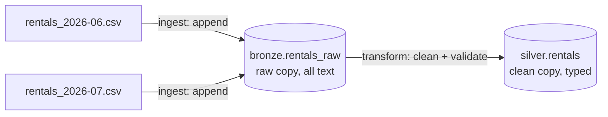

# Assignment: Ruam Bike Lakehouse using pyducklake

Nov 10, 2026 · @Natawut

In this assignment, you will build a small two-layer lakehouse for a bike-share company with pyducklake, by writing four functions, q1–q4, in `student.py`.

## Scenario

**Ruam Bike** is a (made-up) bike-share service in Bangkok. Members unlock a bike at one station, ride, and return it to any station. There are five stations: **Siam, Samyan, Chamchuri, Lumphini, Silom**.

Every month Ruam Bike's booking system exports all rentals as one CSV file. The data is not perfect: some rows have missing values, some rows make no sense (for example, a ride that ends before it starts), and sometimes a file is loaded twice by mistake.

The operations team wants two things:

1. Keep **every** row exactly as it arrived, so nothing is ever lost.
2. Have a **clean** table they can trust for reports such as revenue per station.

You will build this as a small lakehouse with two layers, just like the MetroRide tutorial:



- **Bronze** = the raw copy. Every value is stored as text, exactly as in the CSV, plus a few columns that say where the row came from.
- **Silver** = the clean copy. Values have real types (time, money, date), and only rows that pass the validation rules get in.

Because DuckLake remembers every change as a **snapshot**, you can also look back at what the tables looked like in the past ("time travel").

## Your tasks at a glance

Each question is one function. They run in order, and each one continues from the lakehouse the previous one left behind.

| Question | What you do | Main pyducklake skills |
| --- | --- | --- |
| q1 | Create the two layers and their tables | `create_namespace`, `Schema.of`, `create_table`, transactions |
| q2 | Load the June file into bronze, then clean it into silver | `append`, commit messages, SQL (`TRY_CAST`, `NOT EXISTS`, `QUALIFY`) |
| q3 | Answer questions about the data, without changing anything | `scan`, `select`, `count`, `to_duckdb`, SQL |
| q4 | Load July, skip a file loaded twice, fix mistakes, look back in time | `upsert`, `delete`, snapshots, `with_snapshot` |

## Environment and files

Use the same versions as the MetroRide tutorial. If the tutorial runs on your machine, this assignment will too.

| Package | Version |
| --- | --- |
| Python | 3.14 or newer |
| pyducklake | 1.0.18 |
| duckdb | 1.5.5 |
| pyarrow | 25.0.1 |
| pandas | 3.0.6 |
| pytz | 2026.5 |

Setup and run:

```
uv sync                    # installs the pinned versions from pyproject.toml
uv run python student.py   # runs q1 → q4 on the sample data
```

(With pip instead: `pip install pyducklake==1.0.18 duckdb==1.5.5 pyarrow==25.0.1 pandas==3.0.6 pytz==2026.5`.)

Files you receive:

```
pyducklake-assignment/
  student.py                      ← write your answers here (the only file you submit)
  pyproject.toml                  ← pinned versions
  data/
    rentals_2026-06.csv           ← June rentals
    rentals_2026-07.csv           ← July rentals
    corrections_2026-07.csv       ← fixes from the finance team
```

**What the driver prepares for you.** The bottom of `student.py` (the "driver") does the setup, so your functions don't have to:

- It deletes and recreates an empty `lakehouse/` folder every run.
- It creates the catalog, named **`lake`**. In SQL, tables are therefore `lake.bronze.rentals_raw` and `lake.silver.rentals`.
- It turns data inlining off, so every write becomes a Parquet file.
- It sets the session time zone to `Asia/Bangkok`.

Then it calls `q1`, `q2`, `q3`, `q4` in order and prints what they return.

## Source data

Each monthly file ("rentals\_2026-0x.csv") has one row per rental. A blank cell means "no value".

| Column | Meaning | Example |
| --- | --- | --- |
| rental\_id | ID of the rental | R0601-001 |
| member\_id | Member who rented the bike | M015 |
| bike\_id | Bike that was used | B103 |
| start\_station | Where the ride started | Siam |
| end\_station | Where the bike was returned (blank if lost) | Samyan |
| started\_at | Start time, in Bangkok time (`+07:00`) | 2026-06-01T08:05:00+07:00 |
| ended\_at | End time (blank if lost) | 2026-06-01T08:27:00+07:00 |
| status | `completed` or `lost` | completed |
| fare\_thb | Fare in baht (blank if lost) | 25.00 |

A few lines of `rentals_2026-06.csv`:

```csv
rental_id,member_id,bike_id,start_station,end_station,started_at,ended_at,status,fare_thb
R0601-001,M015,B103,Siam,Samyan,2026-06-01T08:05:00+07:00,2026-06-01T08:27:00+07:00,completed,25.00
R0601-002,M007,B044,Lumphini,,2026-06-01T09:10:00+07:00,,lost,
R0602-001,M021,B210,Silom,Chamchuri,2026-06-02T00:20:00+07:00,2026-06-02T00:45:00+07:00,completed,30.00
```

Two things to notice from the above sample data:

- R0601-002 is a **lost** bike: no end station, no end time, no fare.
- R0602-001 started 20 minutes after midnight on **2 June** in Bangkok. In UTC that is still 1 June (17:20), so if you take the date in UTC you get the wrong day. Always take the date in **Bangkok time**.

All times in the files are valid. They are text in bronze, so convert them with `TRY_CAST` when you build silver.

**Corrections file.** The finance team sends one fix per line:

```csv
rental_id,action,fare_thb
R0701-014,refare,18.00
R0701-052,void,
```

- `refare`: the fare was wrong, and this is the new fare.
- `void`: the rental should not count at all, so remove it.
- Every `rental_id` in the corrections file is already in silver.

## Table schemas

Columns must be in **exactly this order**, because `append` matches columns by position, not by name.

**`bronze.rentals_raw`**: the raw copy

| # | Column | Type | Required? |
| --- | --- | --- | --- |
| 1–9 | the 9 CSV columns, same names and order | String | optional |
| 10 | source\_file | String (file name only, e.g. `rentals_2026-06.csv`) | required |
| 11 | source\_row\_number | Integer (1 = first data row of the file) | required |
| 12 | file\_sha256 | String (SHA-256 of the whole file, hex) | required |
| 13 | ingested\_at | TimestampTZ (when you loaded it) | required |

**`silver.rentals`**: the clean copy

| # | Column | Type | Required? |
| --- | --- | --- | --- |
| 1 | rental\_id | String | required |
| 2 | member\_id | String | required |
| 3 | bike\_id | String | required |
| 4 | start\_station | String | required |
| 5 | end\_station | String | optional |
| 6 | status | String | required |
| 7 | started\_at | TimestampTZ | required |
| 8 | ended\_at | TimestampTZ | optional |
| 9 | fare\_thb | Decimal(8, 2) | optional |
| 10 | ride\_date | Date: the **Bangkok** date of `started_at` | required |

Example: R0601-001 from the CSV above becomes this silver row:

| rental\_id | member\_id | bike\_id | start\_station | end\_station | status | started\_at | ended\_at | fare\_thb | ride\_date |
| --- | --- | --- | --- | --- | --- | --- | --- | --- | --- |
| R0601-001 | M015 | B103 | Siam | Samyan | completed | 2026-06-01 08:05+07 | 2026-06-01 08:27+07 | 25.00 | 2026-06-01 |

## Validation rules

Bronze accepts **everything**. Silver accepts a rental only if it passes **all** the rules that apply to it. Trim spaces and lower-case `status` before checking, as the tutorial does.

| Applies to | Rule |
| --- | --- |
| every rental | `rental_id`, `member_id` and `bike_id` are present |
| every rental | `start_station` is one of the 5 stations |
| completed | `ended_at` is present, and `started_at < ended_at` |
| completed | `fare_thb` is present and ≥ 0 |

A lost rental only has to pass the two "every rental" rules.

Silver also keeps **only one row per `rental_id`** and only adds rentals that are **not already in silver**.

Examples:

| rental\_id | What the row looks like | Silver? |
| --- | --- | --- |
| R0601-001 | completed, Siam → Samyan, 08:05 → 08:27, fare 25.00 | Accepted |
| R0601-002 | lost, no end station, no end time, no fare | Accepted |
| R0603-017 | completed, but ends at 07:50 and starts at 08:10 | Rejected: end is before start |
| R0605-030 | completed, fare is blank | Rejected: a completed ride needs a fare |
| R0608-002 | start\_station is `Sukhumvit` | Rejected: not one of the 5 stations |
| R0609-011 | member\_id is blank | Rejected: every rental needs a member |

Rejected rentals stay in bronze. Nothing is ever deleted from bronze.

## Problems

Every write must use the **exact commit message** shown.  This is very important as later questions find old snapshots by these messages, so a typo or an extra space breaks them.

### q1: Create the tables

`q1(catalog)`

1. Create the namespaces `bronze` and `silver`.
2. Create `bronze.rentals_raw` and `silver.rentals` with the schemas above.
3. Do all of this inside **one transaction** with the commit message `q1: create tables`. The whole of q1 must produce exactly one snapshot.

**Return** the tables in each namespace, using `list_tables`:

```python
{'bronze': ['rentals_raw'], 'silver': ['rentals']}
```

File: student.py (distributed with the assignment) contains the correct solution to this question.  It is an example how to answer all remaining questions.

### q2: Load June, then clean it

`q2(catalog, csv_path)`, where `csv_path` is the path of `rentals_2026-06.csv`.

**Part A: ingest into bronze.**

1. **File guard:** compute the SHA-256 of the file. If bronze already has a row with this hash, skip the whole file.
2. Read the CSV with **every column as text**, and add the 4 metadata columns.
3. **Row guard:** drop rows whose `rental_id` is already in bronze, and drop repeats of a `rental_id` inside the same file (keep the first one).
4. Append what is left in one transaction with the commit message `q2: bronze ingest rentals_2026-06.csv`.

**Part B: transform into silver.**

1. Take the bronze rows whose `rental_id` is not in silver yet (`NOT EXISTS`).
2. Convert the types with `TRY_CAST`, and compute `ride_date` in Bangkok time.
3. Keep only rows that pass the validation rules, one per `rental_id` (`QUALIFY`).
4. Append them in one transaction with the commit message `q2: silver transform`.

q2 creates exactly **2** snapshots.

**Return** three counts:

```python
{'bronze_appended': 149, 'silver_appended': 141, 'rejected': 8}
```

(The numbers are only examples.) `rejected` = bronze rows that were waiting for silver but failed validation.

**Tip:** write the ingest and the transform as **helper functions**. You will use them again in q4.

### q3: Ask questions about the data

`q3(catalog)`

Read the tables and answer four questions. **Do not write anything**: q3 must create **0** snapshots.

| Key | Question | How |
| --- | --- | --- |
| `silver_rows` | How many rentals are in silver? | `scan().count()` |
| `lost_rentals` | How many of them are lost bikes? | `scan("status = 'lost'").count()` |
| `revenue_by_station` | Total fare of **completed** rentals per **start** station | `to_duckdb()` or SQL; include all 5 stations (0.0 if none), round to 2 decimals |
| `rejected_ids` | Which `rental_id`s are in bronze but **not** in silver? | `NOT EXISTS` across the two layers; sorted list |

**Return** (example numbers):

```python
{'silver_rows': 141,
 'lost_rentals': 7,
 'revenue_by_station': {'Siam': 600.25, 'Samyan': 1007.25, 'Chamchuri': 778.0,
                        'Lumphini': 853.5, 'Silom': 1071.5},
 'rejected_ids': ['R0603-017', 'R0605-030', 'R0608-002', 'R0609-011', 'R0609-025',
                  'R0611-028', 'R0630-034']}
```

### q4: A new month, a repeated file, fixes and time travel

`q4(catalog, month1_csv, month2_csv, corrections_csv)`

Do these steps in this order:

1. **Ingest July** (`month2_csv`) into bronze, with commit message `q4: bronze ingest rentals_2026-07.csv`.
2. **Ingest June again** (`month1_csv`). The scheduler re-ran by mistake, so your **file guard** should skip it. Nothing is written and nothing is committed.
3. **Transform** the new bronze rows into silver, with commit message `q4: silver transform`.
4. **Apply the corrections** in **one** transaction with commit message `q4: silver corrections`:
   - `refare` → `upsert` the rental's **full silver row** with the new fare (join on `rental_id`).
   - `void` → `delete` the rental from silver.
5. **Look back in time:** find the snapshot with the commit message `q2: silver transform` in `table.inspect().snapshots()`, and count silver as it was then with `with_snapshot(<its id>)`.

q4 creates exactly **3** snapshots.

**About upsert.** `upsert` means "update the row if the key already exists, otherwise insert it". Every correction is for a rental that is already in silver, so it always updates. Give it the **whole** silver row (all 10 columns, in order) with only `fare_thb` changed.

**Hint**: finding a snapshot by its message:

```python
snaps = silver.inspect().snapshots().to_pandas()
row = snaps[snaps.commit_message == "q2: silver transform"].iloc[0]
row.snapshot_id
```

**Return** (example numbers):

```python
{'bronze_appended': 149,          # rows added to bronze in q4 (July + June again)
 'silver_appended': 141,          # rows added to silver by the q4 transform
 'rows_after_q2': 141,            # silver at the "q2: silver transform" snapshot
 'rows_after_corrections': 279}   # silver now, after refares and voids
```

## Solution structure

You submit **only** `student.py`. Its shape:

```python
from pyducklake import (Catalog, Schema, required, optional,
                        StringType, IntegerType, TimestampTZType, DecimalType, DateType)

# You may add imports and your own helper functions here,
# for example ingest(catalog, csv_path) and transform(catalog).

def q1(catalog):                    # DO NOT modify this line
    # create namespaces and tables in ONE transaction
    # return {'bronze': [...], 'silver': [...]}
    ...                             # already solved in the distributed student.py

def q2(catalog, csv_path):          # DO NOT modify this line
    raise NotImplementedError("q2 isn't answered yet")

def q3(catalog):                    # DO NOT modify this line
    raise NotImplementedError("q3 isn't answered yet")

def q4(catalog, month1_csv, month2_csv, corrections_csv):   # DO NOT modify this line
    raise NotImplementedError("q4 isn't answered yet")

if __name__ == '__main__':
    # the driver: fresh lakehouse/, Catalog "lake", inlining off, Bangkok time zone,
    # then q1 → q2 → q3 → q4 on the files in data/, printing each result
    ...
```

Rules:

- **Do not change** the `def` lines (names and parameters).
- You may write with the pyducklake API **or** with SQL on `catalog.connection`. Either is fine, as long as the tables, commit messages and number of snapshots are right.
- **Do not hard-code answers.** Your work is checked with **different data** that uses the same file names.
- Each question is checked starting from a **correct** lakehouse made by the earlier questions. A mistake in q2 does not cost you points in q3, but on your own machine q3 runs after **your** q2, so fix earlier questions first.
- Run `uv run python student.py` before you submit. The comments in the driver show what each line should print for the sample data.
